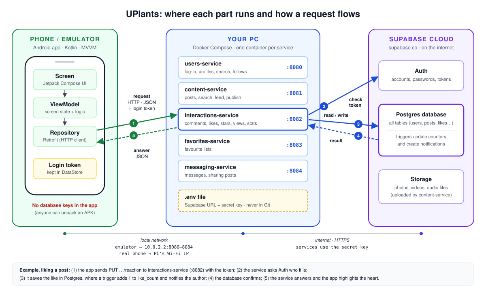

# UPlants

A mobile app for plant lovers to browse, publish and share plant content (photos, videos, audio and text),
built for CC3049 – Mobile Device Programming. The assignment is in [`docs/`](docs/Practical_assignment.pdf).

## Status

**📋 Full checklist: [`docs/REQUIREMENTS.md`](docs/REQUIREMENTS.md)**: every requirement, its status and where it's implemented.
**📄 Project report: [`docs/REPORT.md`](docs/REPORT.md)**: what UPlants is, how it's built, and how each part answers the brief.

| Area | ✅ Done | 🟡 Partial | ❌ Not started |
|---|---|---|---|
| App requirements (1–21) | 0 | 21 | 0 |
| Optional (22–25) | 0 | 0 | 4 |
| Infrastructure (I1–I7) | 0 | 7 | 0 |

Every app requirement has its backend ready (services + database); what's missing is the Android screens.
The optional ones (22–25) are app-side only.
Deadline: **15 December 2026** (report + GitHub link + demo video).

## Architecture

The app never talks to Supabase directly. Each feature is an independent service with its own REST API,
and only the services hold the Supabase keys.
The services run in Docker on the developer's PC; Supabase is in the cloud. More in the [report](docs/REPORT.md#26-where-it-runs).

## Repository layout

| Folder | What's inside |
|---|---|
| [`android/`](android/README.md) | Kotlin + Jetpack Compose app (MVVM) |
| [`database/`](database/README.md) | Supabase schema and the migrations applied to it |
| [`services/users-service/`](services/users-service/README.md) | Accounts, profiles, user search, follows, interests (Kotlin / Ktor, port 8080) |
| [`services/content-service/`](services/content-service/README.md) | Posts & categories: browse, search, personalised feed, publish (Kotlin / Ktor, port 8081) |
| [`services/interactions-service/`](services/interactions-service/README.md) | Comments, likes, ratings, views, post stats (Kotlin / Ktor, port 8082) |
| [`services/favorites-service/`](services/favorites-service/README.md) | Favourite lists with custom names (Kotlin / Ktor, port 8083) |
| [`services/messaging-service/`](services/messaging-service/README.md) | Private messages and sharing posts with other users (Kotlin / Ktor, port 8084) |
| `docs/` | Assignment brief, [requirements checklist](docs/REQUIREMENTS.md) and [project report](docs/REPORT.md) |

## Getting started

1. Copy `.env.example` to `.env` and fill in the Supabase values ([where to find them](database/README.md#keys-who-gets-what)).
   `.env` is git-ignored, so never commit it.
2. **Backend microservices:** Run `docker-compose up --build` from the root directory to start `users-service` on `http://localhost:8080`, `content-service` on `http://localhost:8081`, `interactions-service` on `http://localhost:8082`, `favorites-service` on `http://localhost:8083` and `messaging-service` on `http://localhost:8084`.
3. **Android:** in Android Studio, **File → Open** the `android/` folder (not the repo root).
   It talks to `users-service` on port 8080; to run without a backend, switch to the fake one
   (see [`android/README.md`](android/README.md)).
