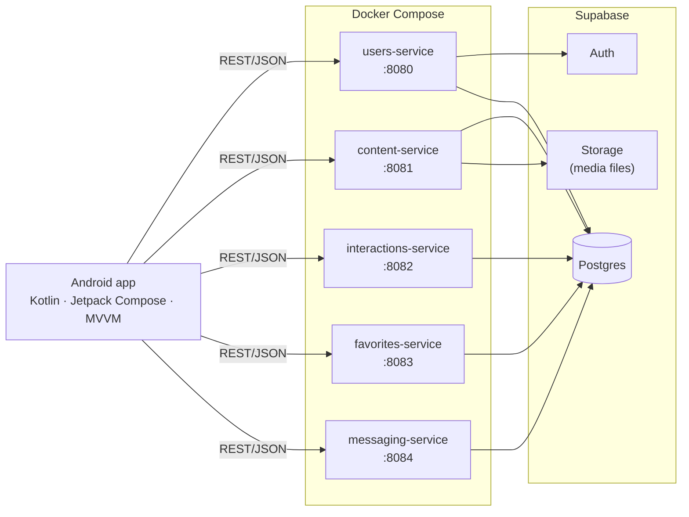
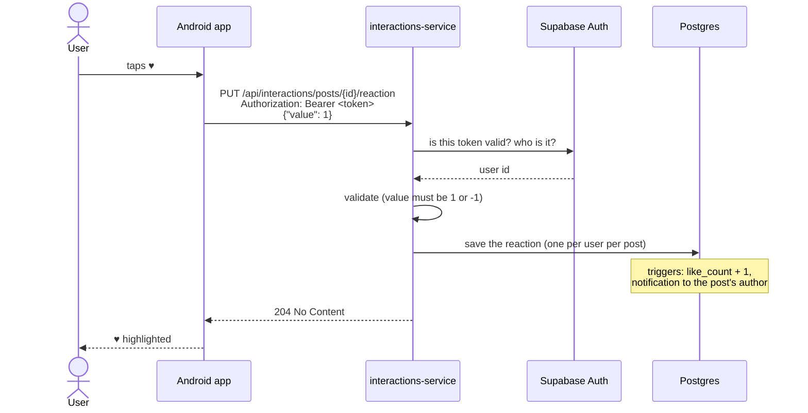
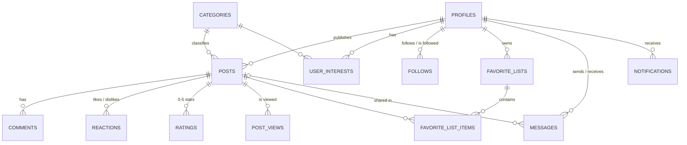

# UPlants – Project report

CC3049 – Mobile Device Programming · Practical assignment ([brief](Practical_assignment.pdf))

> **Status (2026-11-06):** the infrastructure (database + 5 microservices) covers every application requirement (1–21).
> The Android app has the login / sign-up / guest module; the remaining screens are the next step.
> The live status of each requirement is in the [requirements checklist](REQUIREMENTS.md).
> This document explains *what* UPlants is, *how* it is built, and *how* each part answers the brief.

---

## 1. The application

**UPlants** is a mobile social app for plant lovers. People browse, publish and share plant content:
photos of their plants, short videos (repotting, pruning), audio notes, and text tips.

| | |
|---|---|
| **Target audience** | Hobby gardeners and houseplant owners who want to show their plants, get care tips and identify species |
| **Content types** | `photo`, `video`, `audio`, `text` |
| **Categories** | Houseplants · Succulents & Cacti · Vegetables & Herbs · Flowers · Trees & Shrubs · Care Tips · Pests & Diseases · Plant ID |
| **Users** | Visitors (no account): browse and search. Registered users: everything else (publish, comment, rate, follow, save, message) |

Why plants fit a *mobile* app: content is created where the plant is (garden, balcony, nursery), so the phone's
camera, microphone, GPS and sensors are part of each post (where it was taken, light/accelerometer readings while recording).

---

## 2. Architecture



Design decisions:

- **The app only talks to our services, never to Supabase.** Only the services hold the database keys;
  Row Level Security is on with no public policies, so the public Supabase API exposes nothing (migration 004).
- **One service per functionality**, each a separate Kotlin/Ktor project with its own Dockerfile, data model, REST API and tests.
- **Each service owns its tables** and is the only one that writes to them. Reading another service's table is allowed
  (e.g. the feed reads who you follow). Ownership:

  | Service | Owns |
  |---|---|
  | users-service | `profiles`, `follows`, `user_interests` |
  | content-service | `posts`, `categories`, Storage bucket `post-media` |
  | interactions-service | `comments`, `reactions`, `ratings`, `post_views` |
  | favorites-service | `favorite_lists`, `favorite_list_items` |
  | messaging-service | `messages` |
  | *(planned)* notifications-service | `notifications`, `device_tokens` |

- **Authentication:** `users-service` logs users in through Supabase Auth and returns an access token (+ refresh token).
  The app sends it as `Authorization: Bearer …`; every service checks it with Supabase before acting for that user.
- **Work the database does by itself:** triggers keep the counters on each post (likes, comments, views, shares, rating average)
  and create notifications. Services never recount anything, so feeds can be sorted cheaply.

Tech stack: Kotlin 2 + Ktor 3 (services), Kotlin + Jetpack Compose + Retrofit + DataStore (app),
Supabase (Postgres, Auth, Storage), Docker Compose, Gradle 9.8 / JDK 21.

### 2.1 What the services are

A **service** (microservice) is a small, separate server program that does **one job** and offers it over HTTP.
UPlants has five, one per functionality:

| Service | Its one job | Example call |
|---|---|---|
| users-service | Accounts and people: log-in, profiles, search, follows, interests | `GET /api/users/search?q=ana` |
| content-service | Posts: browse, search, personalised feed, publish, delete | `GET /api/content/feed` |
| interactions-service | What users do on a post: comments, likes, stars, views, stats | `PUT /api/interactions/posts/{id}/reaction` |
| favorites-service | Favourite lists with custom names | `PUT /api/favorites/lists/{id}/posts/{postId}` |
| messaging-service | Private messages and sharing posts | `POST /api/messages` |

Each one is its own Kotlin project, runs in its own Docker container on its own port, has its own tables, its own REST API
and its own tests. They don't call each other: each answers the app directly, using the shared database underneath.

### 2.2 How the app talks to the services

The app never touches the database. For every action it sends an HTTP request (REST, JSON) to the service in charge of
that feature, and shows the answer. Inside the app, this follows MVVM:

```
Screen (Compose)  →  ViewModel  →  Repository  →  Retrofit API  →  HTTP  →  service
     shows UiState      holds state     gets the data     builds the
                        and logic       (cache planned)   request
```

Example: **a registered user likes a post**.



The next time anyone loads that post (from content-service), it already shows the new like count:
the services share the data through the database, not by calling each other.

What every request has in common:

- **Who you are**: after log-in the app keeps the access token (DataStore) and sends it as `Authorization: Bearer …`.
  Visitors send nothing and can still browse and search posts, view profiles, comments and public lists.
- **Where it goes**: each service has its own address (`http://<server>:8080` … `:8084`; from the emulator the server is `10.0.2.2`).
- **What comes back**: JSON on success; on failure always `{"error": "message"}` with a status code the app can act on
  (`401` → ask to log in again, `503` → "this feature is unavailable right now", etc.).

### 2.3 Why this design

1. **The brief asks for it.** Each functionality must be an independent service with its own data model and REST API,
   running in Docker and integrated with Docker Compose, designed for graceful degradation.
2. **A phone can't be trusted with secrets.** Anything inside an APK can be extracted. If the app talked to the database directly,
   the database keys would be in the app and anyone could read or change everything. With services in between, the keys stay on
   the server and every request is checked (who is calling, is the input valid, is this their post/list/message).
3. **A phone has a slow, unreliable network and limited battery.** The services do the heavy work (ranking the feed, grouping the
   inbox, computing stats, uploading to storage) and send back exactly what one screen needs, in one request.
4. **A mobile app should keep working when part of the system fails.** Splitting by feature means a failure stays inside that feature.

### 2.4 Benefits

| Benefit | What it means in UPlants |
|---|---|
| **Security** | Database keys only on the server; Row Level Security blocks the public API; every write checks the user's token and ownership |
| **Fault isolation / graceful degradation** | If messaging-service is down, the feed, posts and profiles still work; only "Messages" shows *unavailable*. If the database is unreachable, services answer `503` with a clear message instead of crashing |
| **Independence** | Each service can be changed, rebuilt, restarted or redeployed without touching the others (`docker compose up --build favorites-service`) |
| **Clear ownership** | Each table has exactly one service that writes it, so it's always clear where a rule lives (e.g. "one rating per user per post" is in interactions-service) |
| **Simpler pieces** | Each service is small (one job, 600–1,000 lines of Kotlin) and has the same layout, so it's easy to read, test and explain |
| **Testability** | Each service has its own unit tests and can be tested on its own with `curl`, without the app |
| **Scalability** | A busy service (e.g. content-service serving the feed) can run in more containers without scaling the rest |
| **A thin app** | The app holds no business rules; it shows data and sends actions. The same services could serve a web or iOS client unchanged |
| **Parallel work** | Services and app screens can be built separately once the API contract is written (each service's README) |

### 2.5 Costs, and how they're handled

| Cost | How UPlants handles it |
|---|---|
| More moving parts (5 servers instead of 1) | Docker Compose starts all of them with one command; all services share the same structure |
| The app must know several addresses | One base URL per service in the app's configuration; a single entry point (API gateway) could be added later |
| Some code repeats between services (token check, error format) | Kept deliberately small and identical; each service stays independent instead of depending on a shared library |
| Data that spans features (e.g. the feed needs follows from users-service) | Services may *read* other tables but only the owner *writes* them; counters are kept by database triggers, so they stay consistent |
| Every request needs a network round-trip | Most screens get what they need in one call; the optional offline cache (requirement 22) is planned for the app |

---

## 3. How UPlants answers the brief

### 3.1 Application requirements

| # | The brief asks | How UPlants does it |
|---|---|---|
| 1 | Registered users and visitors | Sign-up / log-in by username (`users-service`). The app has "Continue as guest". Every read endpoint works without a token |
| 2 | Everyone can view and search contents | `GET /api/content/posts?q=` (full-text search on title, description, species) plus filters by type, category, tag, author |
| 3 | Everyone can view and search users | `GET /api/users/search?q=` (username or display name), `GET /api/users/{id}` |
| 4 | Each registered user has a profile | A database trigger creates the `profiles` row on sign-up. `GET`/`PATCH /api/users/me` |
| 5 | Profile: username, description, published contents | Profile has `username`, `bio`, avatar, post/follower/following counts. Posts: `GET /api/content/posts?author={id}` |
| 6 | Contents are categorised | Every post has a `content_type` and a `category` |
| 7 | Visitors see contents by rating, views, interactions | `sort=rating`, `views`, `interactions` on `GET /posts` (counters kept by triggers, indexed) |
| 8 | Organised by content type | `type=photo\|video\|audio\|text` filter |
| 9 | Registered users get a feed by interests, categories, ratings | `GET /api/content/feed`: ranked by followed authors (+3), interest categories (+2), rating, interactions, freshness (§4.2) |
| 10 | Registered users publish contents | `POST /api/content/posts` (multipart: metadata + file up to 50 MB, stored in Supabase Storage) |
| 11 | Comment | `interactions-service`: list / add / delete comments |
| 12 | Rate (0–5 stars, likes/dislikes) | Both: `PUT /rating` (0–5) and `PUT /reaction` (like = 1, dislike = −1) |
| 13 | Favourite lists with custom names | `favorites-service`: create / rename / delete lists, save posts, private or public lists |
| 14 | Share contents with other users | `messaging-service`: a message with `shared_post_id` (raises the post's `share_count`, notifies the recipient) |
| 15 | Publish from local data or live recording | `source = upload` (gallery) or `live` (recorded in the app) |
| 16 | Contents characterised by type and metrics | Type, category, tags, species, location, sensor data, and counters (views, likes, comments, shares, rating) |
| 17 | Sortable by date, rating, interactions | `sort=recent\|rating\|views\|interactions` |
| 18 | Live recordings use device hardware | Posts store GPS (`latitude`, `longitude`, `location_name`) and any sensor readings (`sensor_data` JSON, e.g. accelerometer, light). **`live` posts must include GPS** |
| 19 | History of own contents + statistics dashboard | History: `GET /posts?author=me`. Dashboard: `GET /api/interactions/posts/{id}/stats` (views per day for 30 days, comments, likes/dislikes, rating histogram) |
| 20 | Social tools: follow, like, rate, messaging | Follow (`users-service`), like/rate (`interactions-service`), messages + inbox + unread count (`messaging-service`) |
| 21 | Notifications (e.g. new contents) | Database triggers create notifications for: new post by someone you follow, comment, like, rating, new follower, message, share. *Listing them and push are planned (`notifications-service`)* |
| 22–25 | *(optional)* Offline, adapt to connectivity / device, graceful degradation | Server side: every service answers `503` with a clear message when the database is unreachable. App side: planned (Room cache, connectivity-aware loading) |

### 3.2 Infrastructure requirements

| The brief asks | How UPlants does it |
|---|---|
| Each service has its own design, data model and interface | 5 separate projects under `services/`, each with its own models, validation, REST routes and README (§4) |
| Services are independent web services | Each is a standalone Ktor (Netty) HTTP server; a service can be down while the others keep working |
| Data accessible through REST APIs (at least one per service) | `/api/users/*`, `/api/content/*`, `/api/interactions/*`, `/api/favorites/*`, `/api/messages/*` (JSON) |
| Each service in its own Docker container(s) | One multi-stage Dockerfile per service (Gradle build → small JRE 21 image) |
| Integrated with Docker Compose | Root `docker-compose.yml` starts all five (`docker compose up --build`), reading keys from `.env` |
| Designed for graceful degradation | Database unreachable → `503 "… temporarily unavailable"` instead of a crash; input is validated before any database call; a broken service doesn't take down the others |
| *(Tasks)* MVVM in each app module | Each screen: `ViewModel` exposing a `StateFlow<UiState>` → screen composable → stateless content composable with `@Preview` |

---

## 4. Modules

Every service follows the same internal layout, so they are easy to compare:

```
Application.kt          starts the server, wires the pieces
plugins/Plugins.kt      JSON, CORS, error handling (503 when Supabase is down)
plugins/Routing.kt      REST routes, login check, input validation
service/*Service.kt     business logic, calls Supabase (PostgREST)
service/Validation.kt   pure input checks (unit tested)
models/*.kt             request / response / database row types
```

Full endpoint references are in each service's README; below is the design summary.

### 4.1 users-service (port 8080): accounts and people

- **Sign-up** checks the username is free (case-insensitive), then creates the Supabase Auth user; a trigger creates the profile.
- **Log-in by username**: a database function maps username → email, then Supabase Auth checks the password.
- **Refresh**: swaps a refresh token for a new access token (they last about 1 hour).
- **Search**: case-insensitive partial match on username and display name; `%` and `_` typed by the user are matched literally.
- **Profiles** return counters (posts, followers, following) and, for a logged-in viewer, whether they follow that user.
- **Follows** are idempotent (following twice does nothing, and sends one notification).
- **Interests**: the categories a user likes; they drive the personalised feed.

| Main endpoints | |
|---|---|
| `POST /login`, `/register`, `/refresh` | Auth |
| `GET /search?q=`, `GET /{id}` | Find and view users |
| `GET`/`PATCH /me`, `GET`/`PUT /me/interests` | Own profile and interests |
| `PUT`/`DELETE /{id}/follow`, `GET /{id}/followers`, `/{id}/following` | Social graph |

### 4.2 content-service (port 8081): posts

- **Browse/search**: one endpoint with full-text search, filters (type, category, tag, author), sorting and paging.
- **Publish**: `multipart/form-data` with a JSON `metadata` part and the media file. The file type must match the content type
  (`image/*` for photos, etc.); text posts have no file. The file is uploaded to Storage first; if saving the post fails, the file is removed.
- **Delete**: only the author; the media file is deleted too.
- **Personalised feed** (`GET /feed`): takes the 200 newest posts by followed authors or in interest categories, plus the 50 most popular,
  and ranks them with a score:

  | Signal | Points |
  |---|---|
  | You follow the author | +3 |
  | Category is one of your interests | +2 |
  | Rating | +0.4 per star |
  | Interactions | +0.5 × ln(1 + interactions) |
  | Age | −0.1 per day (max −3) |

  A new user with no follows or interests gets the best-rated posts (`"personalized": false`). The scoring is a pure function with unit tests.

### 4.3 interactions-service (port 8082): what users do on a post

- Comments (only the author can delete), like/dislike, 0–5 stars. Sending a reaction or rating again replaces the previous one.
- **Views**: visitors count too; the same logged-in user reopening a post within 30 minutes isn't counted twice.
- **Dashboard** `GET /posts/{id}/stats`: total views, views per day for the last 30 days (for a line chart), comments,
  likes/dislikes, rating average and a 0–5 star histogram (for a bar chart).
- `GET /posts/{id}/me` tells the app which buttons to highlight (your reaction and stars).

### 4.4 favorites-service (port 8083): favourite lists

- Lists have a custom name (1–60 chars, unique per user ignoring case) and are private or public.
- Save / remove posts; a list shows post cards (title, media, author, category, rating) newest first.
- `GET /posts/{postId}/lists` returns all your lists with `contains_post`, ready for a "Save to…" sheet with checkboxes.
- Someone else's private list answers `404` (its existence isn't revealed). Public lists appear on profiles.

### 4.5 messaging-service (port 8084): messages and sharing

- A message has a text, a shared post, or both. **Sharing a post is a message with `shared_post_id`**: the database raises the post's
  `share_count` and sends the recipient a `share` notification.
- Inbox: one entry per person with the latest message and unread count; a thread view (paged); mark as read; unread badge count.
- Only the sender can delete a message (the share count goes back down).

### 4.6 Android app

- **Structure** (`android/app/src/main/java/com/uplants/app/`): `data/` (Retrofit APIs, repositories, `SessionStore` on DataStore),
  `ui/` (one package per feature), `AppContainer` for manual dependency injection.
- **MVVM**: `ViewModel` → `StateFlow<UiState>` → `XScreen` (collects state) → `XContent` (stateless, previewable).
- **Built**: login, sign-up (with client-side validation and unit tests), "continue as guest", session saved across restarts,
  a fake backend switch for working without the server.
- **Next**: feed and search, post detail (comments, like, rating), publish with camera / microphone / GPS / sensors, profiles,
  favourite lists, messages, dashboard, then the optional offline cache and connectivity handling.

---

## 5. Data model

Postgres on Supabase. Full schema and migrations: [database/README.md](../database/README.md).



Key points:

- **`posts`** holds the content and its metadata: type, source (`upload`/`live`), title, description, species, tags,
  media URL, GPS, `sensor_data` (JSON), and denormalised counters. `interaction_count` (likes + dislikes + comments + shares + ratings)
  and the full-text `search_vector` are generated columns.
- **Triggers** (migrations 003, 008) keep the counters right on every insert/update/delete and create notifications.
- **Constraints** live in the database too: usernames unique ignoring case, no self-follow or self-message, star range 0–5,
  text lengths, and `ON DELETE CASCADE` so deleting a user or post cleans up everything that depends on it.
- **Indexes** for every sort and search used by the services (date, rating, interactions, views, username, full-text).

---

## 6. Interface

The REST interface of each service is documented with request and response examples in its README:
[users](../services/users-service/README.md) ·
[content](../services/content-service/README.md) ·
[interactions](../services/interactions-service/README.md) ·
[favorites](../services/favorites-service/README.md) ·
[messaging](../services/messaging-service/README.md).

Common rules across all services:

- JSON in and out (publishing uses `multipart/form-data` for the file).
- Paging with `limit` (1–50, default 20) and `offset`.
- Errors are always `{"error": "message"}` with a meaningful status: `400` bad input, `401` login needed or expired,
  `403` not yours, `404` not found, `409` already exists, `503` database unreachable.

The mobile user interface (screens) will be documented here as each app module is built.

---

## 7. Testing

- **Unit tests** in every service for the pure logic (validation, feed scoring, inbox grouping, stats maths) and for the HTTP layer
  (login required, bad input refused before touching the database). Run with `./gradlew test` in each service.
- **End-to-end smoke tests** against the real Supabase project with temporary accounts: sign-up, search, follow, interests, feed ranking,
  favourite lists, messages and shares, checking the counters and notifications the triggers produce; test data deleted afterwards.
- **App**: unit tests for form validation; a fake backend to run the UI without the server.

---

## 8. Running it

1. Copy `.env.example` to `.env` and fill in the Supabase URL and keys ([where to find them](../database/README.md#keys-who-gets-what)).
2. `docker compose up --build` from the repo root → services on ports 8080–8084.
3. Open `android/` in Android Studio and run the `app` configuration (emulator reaches the PC at `10.0.2.2`).

---

## 9. What's left

| Item | Notes |
|---|---|
| Android screens for requirements 2–21 | The services they need are ready |
| `notifications-service` | List / mark notifications as read, push via `device_tokens` (the database already creates the notifications) |
| Optional 22–25 | Offline cache (Room), adapt to connectivity and device, graceful degradation in the app |
| Final report + demo video | This document is the base for the report |
